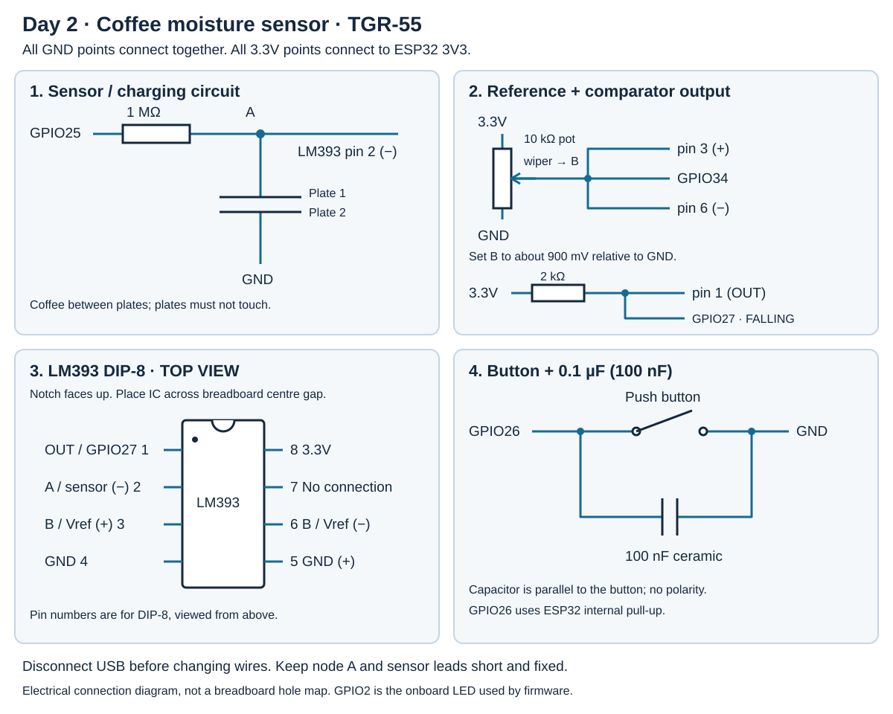

# Day 2 — เครื่องวัดความชื้นเมล็ดกาแฟด้วยแผ่น PCB

สถานะ: แผนและ firmware สำหรับทดลอง/เตรียมแข่ง มี reference labels แล้ว แต่ยังไม่มีเวลาวัดจากเซนเซอร์กาแฟ จึงยังไม่มี coefficient ที่รับรอง ห้ามใช้สมการตัวอย่างในสไลด์เป็น calibration จริง

## 1. เป้าหมายและข้อกำหนด

วัด **ความชื้นในเมล็ดกาแฟ (%)** ไม่ใช่ความชื้นสัมพัทธ์อากาศ (%RH) ใช้กล่องและแผ่น PCB ของผู้จัดเป็นตัวเก็บประจุ เมล็ดกาแฟเป็นวัสดุระหว่างแผ่น สนามไฟฟ้าและความจุเปลี่ยนตามน้ำและการบรรจุ

แหล่งข้อมูล: สไลด์ Day 2 ที่ผู้ใช้ส่ง หน้า 9, 17, 23–31; กติกา Track 1 เดิมสำหรับรูปแบบ Serial ทีมเลือก Method 1 LM393 ต่อจาก Day 1 หากผู้จัดเปลี่ยนกติกา Day 2 ให้ยืนยันรูปแบบอีกครั้ง สไลด์ตัวอย่าง OLED ไม่ได้หมายความว่าต้องซื้อ OLED เพิ่ม

- ESP32 DOIT DEVKIT V1; ทีม TGR-55; Serial 9600 baud
- กดปุ่มหนึ่งครั้งได้หนึ่งผล มี LED 200 ms เป้าหมายตอบกลับ <3 s
- รูปแบบเดิม: `TGR-55` แล้ว `Moisture Level = 10.00 %` แล้วบรรทัดว่าง
- สไลด์หน้า 31 ระบุวัดกาแฟไม่ทราบความชื้น 2 ตัวอย่าง
- ไม่คัดลอก PDF/private material เข้า repository

## 2. Reference ที่ผู้ใช้มี

| ID | มวลที่ผู้ใช้แจ้งของถุง | ความชื้นอ้างอิง |
| --- | ---: | ---: |
| A | 35.74 g | 11.4% |
| B | 35.10 g | 14.4% |
| C | 70.29 g | 6.6% |

น้ำหนักข้างบนเป็นข้อมูลถุงที่ผู้ใช้ให้ ไม่ใช่คำสั่งให้เททั้งหมดลงกล่อง ความชื้นเป็นค่าบน reference label ไม่ใช่ผลวัดที่เราสร้างขึ้น ยังไม่ยืนยัน uncertainty หรือ wet/dry basis ให้ใช้ฐานเดียวกับเครื่อง/ค่ามาตรฐานของผู้จัด ห้ามเอาน้ำหนักถุงมาคำนวณความชื้นโดยตรงหรือผสมถุงเพื่อสร้าง reference ใหม่โดยเดาค่า

## 3. หน้าตาเซนเซอร์และวงจร

### รูปต่อวงจรครบชุด



[เปิดรูปขนาดเต็ม](docs/wiring/coffee_day2.svg) — เปิด Markdown Preview ใน VS Code ด้วย `Ctrl+Shift+V` เพื่อดูรูป ภาพนี้เป็นผังการเชื่อมต่อทางไฟฟ้า ไม่ใช่ตำแหน่งรูบน breadboard จุด GND ทุกจุดต้องต่อถึงกัน และจุด 3.3V ทุกจุดมาจากขา 3V3 ของ ESP32 **ถอด USB ก่อนแก้สาย**

วิธีอ่านรูปและลงสาย:

1. วาง **LM393 แบบ DIP-8 คร่อมร่องกลาง breadboard** มองจากด้านบนโดยหันรอยบากขึ้น ขาซ้ายเรียง 1–4 จากบนลงล่าง ส่วนขาขวาเรียง 8–5 จากบนลงล่าง ตรวจเครื่องหมายบน IC จริงก่อนต่อ
2. **จุด A** รวมปลาย R 1 MΩ, LM393 ขา 2 และแผ่นเซนเซอร์ที่ 1 เข้าด้วยกัน แผ่นเซนเซอร์ที่ 2 ต่อ GND ไม่ใส่ C เซรามิก 5–20 pF ขนานเพิ่ม สายตรงจุดนี้ควรสั้นและไม่ขยับ
3. **จุด B** มาจากขา wiper ของ potentiometer 10 kΩ แล้วแยกไป LM393 ขา 3, ขา 6 และ GPIO34 ขาปลายทั้งสองของ potentiometer ต่อ 3.3V และ GND สำหรับชนิดสามขาเรียงทั่วไป wiper คือขากลาง แต่ให้ตรวจรุ่นจริง ตั้งจุด B ประมาณ 900 mV เทียบ GND ด้วยคำสั่ง `r` แล้ว Enter ใน `coffee_test`
4. **จุด OUT** รวม LM393 ขา 1, GPIO27 และปลาย R pull-up 2 kΩ อีกปลายของ R ต่อ 3.3V ไม่ใช่ 5V
5. **ปุ่มกด** ต่อระหว่าง GPIO26 กับ GND และต่อ C 0.1 µF (100 nF) ขนานกับปุ่ม: C ขาหนึ่งอยู่ฝั่ง GPIO26 อีกขาอยู่ฝั่ง GND ขาทั้งสองของ C ห้ามเสียบอยู่กลุ่มรูที่เชื่อมถึงกัน สำหรับปุ่ม 4 ขา ให้เลือกคู่ที่เชื่อมถึงกันเฉพาะตอนกด ไม่เลือกคู่ที่ต่อถึงกันอยู่แล้วตลอดเวลา หากไม่แน่ใจให้ตรวจ continuity ตอนถอดไฟ ไม่ตัดสินจากทิศทางขาอย่างเดียว
6. จ่าย 3.3V เข้า LM393 ขา 8; ต่อขา 4 และขา 5 ลง GND; ขา 7 เว้นไว้ เชื่อม GND ของวงจรกับ ESP32 ให้ครบ หากรางไฟ breadboard แบ่งครึ่ง ต้องเชื่อมส่วนที่ใช้งานให้ถึงกัน

ภาพแสดง C 100 nF **คร่อมปุ่ม** ตามอุปกรณ์ที่มี ไม่ใช่ C ของเซนเซอร์หรือ C decoupling ของ IC เมื่อเปลี่ยนสายเสร็จแล้ว ให้เก็บ baseline กล่องเปล่าและคาลิเบรตด้วย layout นี้ใหม่

สไลด์หน้า 9 แสดง **แผ่น PCB สี่เหลี่ยมผืนผ้า 5 × 10 cm** สองแผ่นในกล่อง ช่องระหว่างแผ่นเมื่อใส่แล้วประมาณ **1 cm** ไม่ใช่ C เซรามิกอีกตัว ตรวจของจริงว่าเป็นขั้วไหน ทองแดงด้านใดทำหน้าที่เป็น electrode และระยะจริงตรงหรือไม่ อย่าต่อแผ่นให้แตะกันหรือสร้างสะพานนำไฟฟ้าระหว่างแผ่น

วงจรใช้ของเดิม เปลี่ยน C เซรามิกเป็นแผ่นเซนเซอร์ทั้งชุด:

```text
GPIO25 -- R 1 MΩ -- จุด A ----- LM393 ขา 2 (-)
                      |
                แผ่น sensor 1
                  [เมล็ดกาแฟ]
                แผ่น sensor 2
                      |
                     GND

3.3 V ----- ขานอก pot 10 kΩ
GND ------- ขานอกอีกข้าง
ขากลาง pot -- จุด B -- LM393 ขา 3 (+)
                     +-- GPIO34
                     +-- LM393 ขา 6 (comparator ที่ไม่ใช้)

3.3 V -- R 2 kΩ -- จุด OUT -- LM393 ขา 1
                            +-- GPIO27 (FALLING interrupt)

GPIO26 -- สวิตช์ -- GND
   |                 |
   +---- 100 nF -----+

LM393 ขา 8 = 3.3 V; ขา 4 = GND
LM393 ขา 5 = GND; ขา 7 ไม่ต่อ
GPIO2 = LED บนบอร์ด; ESP32 และวงจรใช้ GND ร่วมกัน
```

ตำแหน่งขา IC ให้ดู notch/จุดขา 1 ของ DIP-8 จากด้านบน อย่าอ้างอิงซ้ายขวาอย่างเดียว ตัดไฟก่อนแก้สาย หากเซนเซอร์มีมากกว่า 2 ขั้ว/แผ่นหรือเดินลายหลายด้าน ต้องตรวจการต่อภายในก่อน ไม่เดาขั้วจากสีสาย

R 2 kΩ เป็น pull-up ตามคำแนะนำกรรมการใน session นี้ แม้ภาพตัวอย่างสไลด์ใช้ 10 kΩ ส่วน pot 10 kΩ ใช้แทน R2/R3 เพื่อสร้าง reference ประมาณ 900 mV ตั้งแล้วห้ามหมุนระหว่าง calibration/แข่งขัน กำหนดช่วงตรวจเบื้องต้น 850–950 mV ไม่ใช่ช่วงรับรองความแม่นยำ

LM393 ธรรมดามีข้อจำกัด input common-mode ต่ำกว่าไฟเลี้ยง จึงไม่ยก reference ไป 2.086 V เพียงตามกราฟ 63.2% เมื่อจ่าย 3.3 V ดู [TI datasheet](https://www.ti.com/lit/ds/symlink/lm393.pdf) และรุ่นจริงก่อนเปลี่ยน threshold

ใช้สาย sensor สั้นและยึดตำแหน่ง ไม่จับแผ่น/สายขณะวัด ห้ามย้าย breadboard หรือรูเสียบหลังสอบเทียบ ถ้าผู้จัดอนุญาตและมี C decoupling เพิ่มจึงใส่ใกล้ IC ได้ แต่แผนนี้ไม่สมมติว่ามีอุปกรณ์เพิ่ม: 100 nF ที่มีอยู่ใช้คร่อมสวิตช์เดิม

## 4. หลักการและแบบจำลอง

GPIO25 LOW คายประจุ 2 ms; ต้องเห็น comparator HIGH ก่อนเริ่ม GPIO25 HIGH เริ่มจับ cycle count เมื่อแรงดัน sensor ผ่าน 900 mV LM393 เปลี่ยน HIGH→LOW และ ISR จับเวลา ทำ 64 ครั้ง ใช้ median พร้อมรายงาน MAD เพื่อดูการแกว่ง ตั้ง CPU 240 MHz, timeout ต่อครั้ง 5 ms ทุกค่าต้องผ่านครบ ไม่ตัด batch เสียทิ้งเพื่อทำให้ผลดูดี

เชิงอุดมคติ `C = -t / (R * ln(1 - Vref/Vcharge))` ต้องมีเครื่องหมายลบเพื่อ C เป็นบวก แต่เวลาจริงรวม delay, C แฝง และอาจมี leakage จากเมล็ด/ผิวแผ่น จึงไม่เอาค่า pF จากสูตรนี้เป็นค่ามาตรฐาน และไม่เอา slope/intercept ของ C 5–20 pF จาก Day 1 มาใช้กับ sensor ใหญ่โดยอัตโนมัติ

เลือกแบบจำลองเริ่มต้น:

```text
feature_us = median_time_loaded_us - fixed_empty_time_us
moisture_percent = a * feature_us + b
```

นี่คือ empirical regression จากการตอบสนองของเซนเซอร์ capacitive โดยตรง ที่ R/threshold คงที่ ความสัมพันธ์เชิงเส้นกับเวลาเทียบเท่าความสัมพันธ์เชิงเส้นกับ C ที่แปลงด้วย affine calibration ช่วยหลีกเลี่ยงการอ้างค่า pF ที่ยังไม่ได้สอบเทียบ ไม่มี universal formula ที่แปลงน้ำหนักถุงหรือ dielectric constant เป็นความชื้นของชุดนี้โดยไม่เก็บข้อมูล

Baseline กล่องเปล่ารวม C ของกล่อง อากาศ สาย และวงจร ไม่ใช่ C แฝงล้วน การลบนี้ไม่ทำให้ geometry/packing/temperature ไม่มีผล ห้ามกด zero ขณะมีกาแฟหรือเปลี่ยน baseline ในวันแข่งโดยไม่ตรวจโมเดลเดิม

สมการ `M = 0.091C - 3.80` ในหน้า 25–29 เป็น **ตัวอย่าง** ห้ามนำ coefficient นั้นมาส่งแข่ง R² สูงกับข้อมูลฝึกไม่ได้รับรอง unknown-sample accuracy

## 5. ขั้นตอนทดลอง

1. ตรวจ reference และวงจรด้วยโค้ด `coffee_test` วัดกล่องเปล่า 15 batches อย่างน้อย 2 รอบ เก็บภาพ layout และทำเครื่องหมายตำแหน่งสาย
2. กำหนดระดับเติมเดียวกันที่ทุกถุงมีปริมาณพอ ครอบคลุมพื้นที่แผ่นเท่ากัน ไม่ใช้ถุง C ทั้ง 70.29 g ถ้า A/B เติมได้เพียงระดับต่ำกว่า ใช้ขั้นตอนเขย่า/เคาะคงที่และบันทึกน้ำหนักที่ใช้จริงถ้ามีเครื่องชั่ง ห้ามกดอัดแน่นด้วยมือโดยไม่กำหนดวิธี
3. เริ่มตัวอย่าง C=6.6%, A=11.4%, B=14.4% แล้วสลับลำดับในรอบถัดไปเพื่อตรวจ drift อย่าเทกลับผิดถุง เก็บแยกและปิดถุงเมื่อไม่ใช้ รักษาอุณหภูมิใกล้กัน
4. ต่อ reference หนึ่งระดับ: เติมหนึ่งครั้ง → วัด 15 batches → เทออกทั้งหมด → เติมใหม่ เป็น **refill ใหม่** ทำ 5 refills ต่อระดับ ตั้ง ID refill01–refill05
5. กำหนดล่วงหน้า refill01–03 เป็น training, refill04–05 เป็น validation สำหรับทุกถุง ไม่สุ่มแถวจาก refill เดียวกันให้ไปอยู่ทั้งสองฝั่ง
6. ตรวจ median, MAD, reference และสถานะ ถ้าไม่มีแนวโน้มแยกตามความชื้น ให้แก้ความคงที่การบรรจุ/วงจรก่อนเพิ่ม polynomial ไม่สมมติว่าจำนวน readings มากแก้ bias ได้
7. Fit เส้นตรงจาก 3 ระดับอ้างอิง รายงาน R² ฝึก, validation MAE/RMSE หน่วย percentage points, bias ต่อถุง และตรวจ range ก่อนใช้ ไม่เรียกค่าเหล่านี้เป็นคะแนนกรรมการโดยไม่มีการยืนยันกติกาความชื้น
8. หาก validation ไม่ผ่านเป้าหมายที่ตกลงกับกรรมการ ให้เก็บใหม่ตามสาเหตุ เก็บ known-bag checks ก่อน/หลังชุดข้อมูลเพื่อดู drift การเปลี่ยน R หรือ threshold ต้องเริ่ม calibration ใหม่

ไม่มีข้อมูลอ้างอิงนอก 6.6–14.4% จึงไม่รับรองค่าที่ไกลช่วงนี้ ความถี่/รูปคลื่น RC แบบ DC อาจไวต่อ leakage ถ้าจุดเริ่มไม่ HIGH หรือชาร์จไม่ถึง threshold ห้ามแปลง timeout เป็นความชื้นสูง ให้ตรวจ moisture/leakage/contact และพิจารณาวิธีวัดใหม่เฉพาะเมื่อมีหลักฐานและชุดข้อมูลใหม่

## 6. ไฟล์และการใช้จริง

- `firmware/coffee_test/coffee_test.ino`: run อัตโนมัติ 15 batches, m วัดหนึ่งครั้ง, r ดู reference, stop ยกเลิก (ทุกคำสั่งตามด้วย Enter), ปุ่มใช้วัดครั้งเดียว
- `firmware/coffee_competition/coffee_competition.ino`: ปุ่มอย่างเดียว, ไม่มี CSV/diagnostic, ทีม TGR-55, 9600 baud, LED 200 ms
- `firmware/coffee_common/`: source หลักของ acquisition และ moisture calibration; sync เป็นสำเนาเหมือนกันในสอง sketch เพื่อ Arduino IDE เปิดแต่ละโฟลเดอร์ได้
- `calibration/coffee/coffee_data.py`: capture ตรง COM หรือ import PuTTY log, เก็บ metadata แล้ว fit แบบแยก refills

`READY=false` และ coefficient เป็น NAN ในไฟล์เริ่มต้น จึงยังไม่ให้ค่าความชื้นที่ใช้จริง Test แสดง UNAVAILABLE; competition แสดง `Moisture Level = 0.00 %` เป็น failure sentinel ชั่วคราว ไม่ใช่ค่า moisture จริง ต้องยืนยันรูปแบบ failure กับผู้จัด **ห้ามส่งแข่งก่อนใส่โมเดลและเปลี่ยน READY=true หลังตรวจ validation** การมีไฟล์แข่งขันไม่ได้หมายความว่ารับรองความแม่นยำแล้ว

## 7. Checklist ก่อนส่ง

- วงจรและ sensor ยึดแน่น ใช้ geometry/refill procedure เดียวกับ calibration
- มี baseline และ labelled dataset ครบ 3 ระดับพร้อม refills ที่แยกฝึก/ตรวจ
- Header ทั้งสองชุดตรงกัน; coefficient ไม่ใช่ตัวอย่าง; READY=true; ไม่มี NAN
- เปิดเครื่องแล้วปล่อยปุ่มก่อนเริ่ม กด 5 ครั้งได้ 5 ผล กดค้างไม่ซ้ำ
- ตรวจด้วย PuTTY ที่ 9600 8N1 ไม่มี flow control, log แยกจากช่วงสอบเทียบ
- ตรวจเวลา <3 s และ LED บนบอร์ดจริง; ไฟเลี้ยงและ pin polarity ถูกต้อง
- ลอง known-bag checks หลังอัปโหลด competition; ไม่มีการใช้คำสั่ง m แทนปุ่มใน rehearsal สุดท้าย
- ไม่เปลี่ยนวงจร baseline หรือ pot หลัง freeze เก็บ hash/source ที่ส่งและภาพวงจร

## แหล่งอ้างอิงและข้อที่ยังต้องยืนยัน

Day 2 PDF ของผู้ใช้ หน้า 9 (geometry), 17 (LM393 inverting), 23–25 (coffee dielectric และ regression), 28–30 (equations/parasitics), 31 (unknown samples) เก็บเอกสารไว้ภายนอก repo กติกา Serial/LED มาจาก Track 1 เดิม ต้องยืนยันว่าผู้จัดไม่ได้เปลี่ยนใน Day 2

ยังต้องยืนยัน moisture basis/uncertainty, fill amount/packing ที่ผู้จัดจะใช้, failure-output convention และเกณฑ์คะแนนความชื้น ไม่อ้างว่าใช้เกณฑ์ capacitance เดิมอัตโนมัติ
